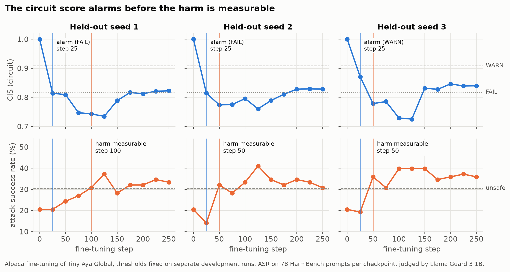
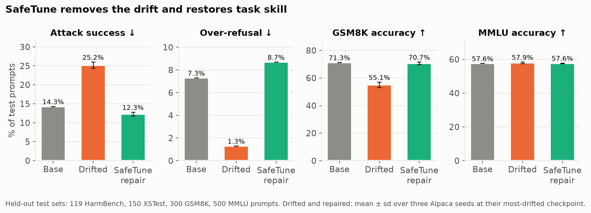

# SafetyPulse: Catching Safety Drift During Fine-Tuning by Reading the Model's Refusal Circuit

*Lexsi Labs AI Safety & Alignment Hackathon · Track 2b (AI Safety and Correction) · Model: Cohere Labs
[Tiny Aya Global](https://huggingface.co/CohereLabs/tiny-aya-global) (3.35B) · Toolkits: CuratorKIT, CircuitKIT,
SafeTune, AuditKIT · Code: [PxA-Labs/safetypulse](https://github.com/PxA-Labs/safetypulse) · Package:
[`pip install safetypulse`](https://pypi.org/project/safetypulse/) · Artifacts:
[models](https://huggingface.co/collections/purvansh01/safetypulse-models-6af00b8f56c773a80af9f7e0),
[datasets](https://huggingface.co/collections/purvansh01/safetypulse-data-6af00b9124ee9d5022a36482)*

## TL;DR

- **The problem.** Fine-tuning an aligned model on harmless data quietly weakens its refusals. On Tiny Aya, 2,000
  Alpaca instructions raise the attack success rate (ASR) on held-out HarmBench prompts from **14.3% to 25.2%**.
- **The monitor.** We locate the model's refusal circuit once and score every checkpoint with a **Circuit Integrity
  Score (CIS)** from 50 prompt pairs. With thresholds fixed in advance, it flags **every unsafe held-out checkpoint**
  (recall 1.00 at precision 0.46: it also warns on a safe maths fine-tune) and warns **1–3 checkpoints before** the
  harm is measurable, a lead bounded by our checkpoint spacing. A 50-prompt refusal spot-check, at its own
  threshold, catches 13%.
- **What the mechanism adds.** Scores that measure the *strength* of the refusal signal beat orientation-only drift
  scores, which miss a fading signal and false-alarm when refusal gets stronger. Comparing all signals afterwards, the
  simple direction projection was the best alarm on our held-out runs, and every CIS variant warned before the
  spot-check on two of three seeds.
- **The repair.** Restoring the circuit's own weights does nothing: the circuit *reads out* the drift but does not
  *store* it. SafeTune's low-rank restore, the closest rank-k rollback to the base weights, removes the drift
  (ASR 25.2% → 12.3%) and recovers lost task accuracy (GSM8K 55.1% → 70.7%) by undoing about 86% of the fine-tune's
  weight change.
- **The result.** A repaired model that is safer *and* more capable than the fine-tune it came from, and statistically
  level with the base model:
  [`tiny-aya-global-safetypulse-repaired`](https://huggingface.co/purvansh01/tiny-aya-global-safetypulse-repaired).


*Animation 1. One held-out fine-tuning run, checkpoint by checkpoint: the alarm at step 25 comes three checkpoints
before the harm is measurable (seed 1; one checkpoint earlier on the other two seeds, Figure 2).*

---

## 1. The problem

Safety alignment is fragile under fine-tuning: even benign data erodes it (Qi et al., 2023). The teams affected are
those who adapt open-weight models to a domain or a language, often without a red-team. Catching the erosion means
auditing every checkpoint, generating answers to hundreds of harmful prompts and judging them, so it is usually
skipped, and a model that refuses less gets shipped.

We want a signal that is **light** enough to run at every checkpoint, **early** enough to stop or repair a run before
harm is measurable, and **grounded** in *why* the model refuses rather than in a handful of prompts, plus a repair
that does not throw the fine-tune away.

Put together, these make a **safety regression gate** for fine-tuning, the way a test suite gates a code change:
**check** every checkpoint, **decide** PASS / WARN / FAIL with thresholds fixed in advance and validated on held-out
runs, **repair** a failing model, and **verify** the repair with a paired audit. SafetyPulse is that gate.

## 2. Related work and contribution

Fine-tuning compromises safety even on benign data (Qi et al., 2023); safety-critical behaviour sits in a small,
brittle set of weights (Wei et al., 2024); and refusal is mediated by a single direction in the residual stream
(Arditi et al., 2024).

**Monitoring drift is not new.** ProCon (Du et al., arXiv 2509.06795) shows the refusal direction drifts during
instruction tuning and constrains it in training; RefusalGuard (arXiv 2605.01913) links representation drift to
harmful compliance; Trait-space Monitoring (Nghiem et al., arXiv 2606.07631) tracks alignment-relevant directions
during LoRA fine-tuning and evaluates the monitor on held-out runs (four 7–9B models, 468 checkpoints, AUROC 0.989),
for emergent misalignment; the Safety Compass package logs the drift of safety directions during training; and
per-sample risk scores from parameter updates have been proposed (arXiv 2605.04572). Other work cautions that
preserving the refusal direction is not always a reliable proxy for behavioural safety (arXiv 2610.38001) and that
displacement alone can miss a collapse in guard models (arXiv 2605.02914).

**On repair,** Safe LoRA projects LoRA updates onto an alignment subspace (Hsu et al., 2024), and SafeSeek locates
safety circuits and protects them during fine-tuning (arXiv 2603.23268). Recent analyses find that benign fine-tuning
breaks the *routing* of safety information to a refusal in the final layers (Guo et al., arXiv 2609.01455), and that
after few-sample *harmful* fine-tuning, removing the update's top two singular directions restores refusal (Lee et
al., arXiv 2610.00320).

**Beyond English and beyond one model.** Benign fine-tuning shifts safety differently in each language, and
evaluating in English alone gives inadequate assurance (Hawkins et al., arXiv 2606.28843); an English refusal
direction does transfer across languages for *bypassing* refusal (Wang et al., arXiv 2505.17306), but whether it can
*monitor* non-English drift is untested. Frozen activation monitors can go stale after fine-tuning (Duan, arXiv
2606.15980); auditing agents detect adversarial fine-tuning jobs but call subtle benign degradation an open problem
(Egler et al., arXiv 2510.16255); and benign data that is formatted as lists or maths questions is unusually harmful
to safety (He et al., arXiv 2404.01099). Our test plan for these questions is pre-registered
([docs/13](https://github.com/PxA-Labs/safetypulse/blob/main/docs/13_PREREGISTRATION.md)).

**Our contribution:**

1. A **refusal-drift monitor for benign fine-tuning** whose signals, including a causally located circuit, are
   compared as **alarms on held-out runs** against a behavioural spot-check, with lead time per checkpoint.
2. A **causal test of circuit-restricted repair** on benign drift: restoring the components that read out refusal
   fails, while a low-rank whole-model rollback succeeds.
3. Evidence that **data curation does not prevent the drift**.
4. A **tested, installable package** (`safetypulse`: check, repair, audit, Trainer callback) inside a pipeline that
   chains all four Lexsi Labs toolkits (CuratorKIT and AuditKIT run in the notebooks and HF Jobs), with every artifact
   public.

## 3. Method

### 3.1 Calibration (once per base model)

- **Matched pairs.** 288 AdvBench harmful prompts, each with a minimally edited harmless twin of similar topic and
  length ("…hack into secure computer systems" → "…back up home computer systems"), so the contrast isolates harmful
  *intent*. Split 50 probe / 50 validation / 188 calibration.
- **Refusal score.** For a prompt \\(x\\), with \\(R\\) the tokens that begin a refusal and \\(C\\) those that begin
  a compliance,

$$
M(x) = \log \sum_{t\in R} p(t \mid x) - \log \sum_{t \in C} p(t \mid x)
$$

- **Refusal direction.** The difference of mean last-token activations between harmful and harmless prompts,
  \\(\hat r\\), at the layer chosen on validation pairs (27 of 36). Removing it drops refusal of held-out harmful
  prompts from 98% to 6%; random directions leave it at 98%.
- **Refusal circuit.** Attribution patching scores every head and MLP \\(c\\) by its effect on \\(M\\) when the
  harmful activation replaces the harmless one, \\(s_c = \mathbb{E}\big[(a_c^{\text{harm}} - a_c^{\text{harmless}})^{\top}\nabla_{a_c} M\big]\\);
  exact activation patching confirms the top set \\(\mathcal{S}\\): 14 MLPs and 6 heads in layers 16–34.

### 3.2 The Circuit Integrity Score

Let \\(d = \bar h^{\text{harm}} - \bar h^{\text{harmless}}\\) be the mean activation difference on the 50 probe
pairs. For a checkpoint \\(t\\), with subscript 0 for the base model:

$$
\mathrm{CIS}_{\text{circ}} = \frac{\sum_{c\in\mathcal S} s_{c,t}}{\sum_{c\in\mathcal S} s_{c,0}}
\qquad\qquad
\mathrm{CIS}_{\text{sep}} = \frac{\langle d_t,\hat r\rangle}{\langle d_0,\hat r\rangle}
$$

$$
\mathrm{CIS}_{\text{cos}} = \frac{\langle d_t, d_0\rangle}{\lVert d_t\rVert \lVert d_0\rVert}
\qquad\qquad
\mathrm{CIS}_{\text{logit}} = \frac{\bar M_t^{\text{harm}} - \bar M_t^{\text{harmless}}}{\bar M_0^{\text{harm}} - \bar M_0^{\text{harmless}}}
$$

Every variant equals 1 for the base model, and for checkpoint 0 of a LoRA run, which starts exactly at the base
weights. Lower is worse. The status is

$$
\text{FAIL if } \mathrm{CIS} < \tau_{\text{fail}}
\qquad
\text{WARN if } \tau_{\text{fail}} \le \mathrm{CIS} < \tau_{\text{warn}}
\qquad
\text{PASS otherwise}
$$

A non-finite score is an ERROR, never a PASS. The primary variant and the thresholds were fixed on development
runs by a rule set before any test run was scored: \\(\mathrm{CIS}_{\text{circ}}\\),
\\(\tau_{\text{fail}} = 0.818\\), \\(\tau_{\text{warn}} = 0.909\\).

### 3.3 Repair, audit and the toolkit chain

Repairs move the drifted weights back towards the base: **R1** restores the circuit's weights, **R3a** applies
SafeTune `wise_ft` to the circuit, **R3b** applies SafeTune's safety-vector restore (§4), **R4** interpolates the
whole model, **R5** restores random components of R1's size (control), and **R6** steers with the refusal direction.
Strengths are chosen on development runs.

The audit reports four metrics, each for a reason: **ASR** on HarmBench (the harm to prevent), **over-refusal** on
XSTest safe prompts (a repair that refuses everything is no fix), **GSM8K** accuracy (task skill) and **MMLU**
(general knowledge), with 95% bootstrap intervals and paired tests.

**Toolkit chain:** CuratorKIT curates the data → LoRA fine-tune → `safetypulse check` at every checkpoint → SafeTune
repairs a failing checkpoint → AuditKIT measures before and after; CircuitKIT independently re-discovers the circuit
that CIS reads.


*Animation 2. The loop with all four toolkits, using the alpaca-s1 checkpoint at step 125 and its repair.*

## 4. Three results behind the method

**Result 1 — Cosine drift scores cannot see a fading refusal signal.** For any \\(\lambda > 0\\),
\\(\mathrm{CIS}_{\text{cos}}(\lambda d) = \mathrm{CIS}_{\text{cos}}(d)\\). So if the harmful–harmless separation
shrinks uniformly, \\(d_t = \lambda d_0\\) with \\(\lambda \to 0\\), the cosine score stays at 1 while the projection
score falls to \\(\lambda\\):

$$
\mathrm{CIS}_{\text{sep}} = \frac{\lVert d_t\rVert}{\lVert d_0\rVert} \cdot
\frac{\cos\angle(d_t,\hat r)}{\cos\angle(d_0,\hat r)}
$$

*Proof.* The scale \\(\lambda\\) cancels in the cosine; the identity follows from
\\(\langle d,\hat r\rangle = \lVert d\rVert \cos\angle(d,\hat r)\\) with \\(\lVert\hat r\rVert = 1\\). \\(\square\\)

A score built only on the *orientation* of a safety direction cannot detect the *strength* of refusal fading, and it
also drops when the direction rotates while refusal gets stronger (which caused a false warning on our negative
control). Scores that include the strength, the direction projection and the circuit score, respond to both.

**Result 2 — SafeTune's restore is the closest rank-k rollback.** A fine-tune changes each weight matrix by
\\(\Delta = W_t - W_0\\), with singular values \\(\sigma_1 \ge \sigma_2 \ge \dots\\). SafeTune's safety-vector
restore (strength 1, rank \\(k\\)) sets \\(W' = W_t + [W_0 - W_t]_k\\), where \\([A]_k\\) keeps the top \\(k\\)
singular directions of \\(A\\). Then

$$
\lVert W' - W_0 \rVert_F^{2} = \sum_{i>k} \sigma_i^{2}
$$

This is the smallest distance to \\(W_0\\) that any correction of rank \\(k\\) can reach, and the restore is exact when
\\(\operatorname{rank}\Delta \le k\\).

*Proof.* \\(W' - W_0 = \Delta - [\Delta]_k\\), and by the Eckart–Young theorem \\([\Delta]_k\\) is the best approximation
of \\(\Delta\\) with rank \\(k\\). \\(\square\\)

A merged LoRA update has rank at most its LoRA rank (16 here), so the rank-8 restore removes the 8 dominant of at
most 16 directions of the fine-tune's change. This matches the finding that removing an update's top singular
directions restores refusal (arXiv 2610.00320), here for *benign* drift. In our three repaired fine-tunes the
rank-8 restore removes 86–87% of the squared weight change (notebook 15, `kaggle/executed/15_judge_followups/`): the repair is mostly a rollback.

**Result 3 — Restoring a component's weights does not restore its activations.** A component computes
\\(a_c = f_c(x_c; W_c)\\) from its input \\(x_c\\). Circuit restore sets \\(W_c \leftarrow W_c^{0}\\), which returns
\\(a_c\\) to its base value only if \\(x_c = x_c^{0}\\), i.e. if nothing upstream changed. LoRA changes every layer,
so this condition fails. CIS is computed from activations, so it sees drift arriving from anywhere upstream (the
circuit *reads it out*); restoring the circuit's weights leaves that drift in place (the circuit does not *store* it).
This is exactly what the repair experiment shows (§6.4).

## 5. Experimental setup

| | Choice | Why |
|---|---|---|
| Base model | Tiny Aya Global (3.35B, 36 layers) | Required model family; preferred over Qwen2.5-1.5B for a cleaner refusal signal (AUROC 0.985 vs 0.86) and far less over-refusal (8% vs 56%) |
| Fine-tuning | LoRA r = 16 on all projections, lr 2·10⁻⁴, 2 epochs, batch 16, ~250 steps, checkpoint every 25 | A realistic small-team recipe |
| Conditions | `alpaca` (2,000 general instructions), `gsm8k` (2,000 math), `none` (negative control: 1,800 Alpaca + 200 refusals), `harm` (positive control: 100 harmful pairs) | Benign drift, domain tuning, a run that should stay safe, a run that must break |
| Runs | Development: seed 0 of each condition (variant, thresholds, repair strengths). Test: seeds 1–2, plus a third Alpaca seed (77 checkpoints) | No test run influences any choice |
| Hygiene | Training prompts that nearly duplicate evaluation prompts removed (344 dropped) | No training on the test set |
| Judge | Llama Guard 3 1B, cross-checked with 8B | Small, local, reproducible |

## 6. Results

### 6.1 Drift: benign, and deliberate

**Benign fine-tuning drifts.** Alpaca raised peak monitoring ASR from 21% to 37–46% on every seed. On the 119
held-out audit prompts the drifted checkpoints reach 25.2% ± 0.8 (base 14.3%), while over-refusal falls from 7.3% to
1.3%: the model refuses less of *everything*. GSM8K fine-tuning and the negative control left it slightly *safer*.

**Positive control: deliberately removing safety.** A monitor is only credible if it fires when safety truly breaks,
so, as planned from the start, we fine-tuned Tiny Aya on 100 harmful request → compliant answer pairs from the public
LLM-LAT research set. By the first checkpoint (step 10), refusal falls from 100% to 0%, ASR reaches 94%, and CIS
FAILs at that same checkpoint. To measure *how early* CIS reacts, we repeated the run with a checkpoint every
2 steps:

| Training step | 0 | 4 | 6 | 8 | 10–30 |
|---|:---:|:---:|:---:|:---:|:---:|
| CIS (status) | 1.00 PASS | **0.89 WARN** | 0.63 FAIL | 0.39 FAIL | 0.04–0.23 FAIL |
| Refusal spot-check | 100% | 98% | 80% | 0% | 0% |
| ASR (78 prompts) | 21% | 24% | **42%, first unsafe** | 92% | 91–96% |

CIS warns **2 training steps (8 examples) before** the harm is measurable, while the spot-check still reads 98%.
These adapters are deliberately unsafe, so their weights are not released (§10).


*Figure 1. Positive control: CIS warns at step 4, while the spot-check still reads 98% and before attack success
becomes unsafe at step 6.*

### 6.2 Monitoring held-out runs



*Figure 2. On three held-out fine-tuning runs, the circuit score raises its alarm at step 25, one to three
checkpoints before the attack success rate becomes unsafe.*

| Signal | Spearman ρ with ASR (95% CI) | Precision | Recall |
|---|:---:|:---:|:---:|
| **CIS circuit, WARN or FAIL** | **−0.80 [−0.85, −0.71]** | 0.46 | **1.00** |
| CIS circuit, FAIL only | | 0.68 | 0.57 |
| CIS direction cosine | −0.57 [−0.71, −0.35] | | |
| CIS direction projection | −0.56 [−0.69, −0.34] | | |
| CIS refusal logit | −0.39 [−0.59, −0.15] | | |
| Refusal spot-check, 50 prompts | −0.83 [−0.86, −0.75] | 0.75 | 0.13 |

| Alpaca test seed | First unsafe checkpoint | First CIS alarm | First spot-check alarm |
|---|:---:|:---:|:---:|
| seed 1 | step 100 | **step 25 (FAIL)** | step 75 |
| seed 2 | step 50 | **step 25 (FAIL)** | never |
| seed 3 | step 50 | **step 25 (WARN)** | step 100 |

- **Early and complete:** every unsafe test checkpoint is flagged, 1–3 checkpoints before ASR becomes unsafe; the
  negative control never raised an alarm.
- **The lead is bounded by checkpoint spacing.** Every alarm fires at step 25, the first checkpoint. An alarm that
  fires at *every* checkpoint after step 0 has the same lead (3, 1, 1) at precision 0.33, and so does a threshold on
  the size of the weight change ‖ΔW‖ (40 of 44 alarms on safe runs). What reading the mechanism adds is fewer false
  alarms: 20 at WARN and 0 at FAIL for the circuit score, 0 for the direction projection.
- **Ranking is not alarming.** The circuit score ranks checkpoints best across conditions (ρ −0.80), but that comes
  from differences between conditions; within the Alpaca drift it tracks ASR least.
- **The spot-check ranks but barely alarms at its threshold:** an 8-point refusal drop on 50 prompts is within its
  noise, so it catches 13% of unsafe checkpoints (with an added WARN level, 96%, but later; see below).
- **Cost:** one check takes 22 s on an L4 GPU (about USD 0.005); a full ASR audit takes about 2× longer.
- **Precision 0.46:** CIS also WARNs on the GSM8K fine-tune, which moved the circuit without reducing safety (never a
  FAIL).

**All signals as alarms (post hoc).** After the test runs were scored, we applied the same threshold rule to every
signal. The primary score stays as fixed on the development runs; this comparison only reports what we found.

| Signal | FAIL recall | FAIL precision | WARN-or-FAIL recall | Alarms on safe runs (none / GSM8K) | Alpaca lead at WARN |
|---|:---:|:---:|:---:|:---:|:---:|
| CIS circuit (primary) | 0.57 | 0.68 | 1.00 | 0 / 20 WARN | 3, 1, 1 |
| CIS direction projection | **0.96** | **0.85** | 1.00 | **0 / 0** | 3, 1, 1 |
| CIS direction cosine | 0.87 | 0.80 | 1.00 | 20 WARN / 0 | 3, 1, 1 |
| CIS refusal logit | 0.52 | 0.33 | 0.70 | 0 / 20 FAIL | 3, 0, 0 |
| Refusal spot-check, two levels | 0.13 | 0.75 | 0.96 | 0 / 0 | 2, 0, −1 |

The simplest strength-aware score, the projection on the refusal direction, was the best alarm here. The cosine
score false-alarms on the negative control, as Result 1 predicts, and the spot-check catches up on recall once it gets
a WARN level but warns later on two of three seeds. The circuit's value in this project is the explanation it gives
and the repair test below, not a better alarm. Three drifting seeds of one model are too few to rank the signals with
confidence; this needs a pre-registered comparison on a second model. With 95% Wilson intervals, the circuit score's
FAIL recall is 0.57 [0.37, 0.74] and its WARN-or-FAIL recall 1.00 [0.86, 1.00] at precision 0.46 [0.33, 0.60]; the
projection's FAIL recall is 0.96 [0.79, 0.99] at precision 0.85 [0.67, 0.94]. Within the Alpaca drift the circuit
score barely tracks ASR (ρ −0.04, against −0.31 for the projection), and with a stricter unsafe cut-off (base + 15
points) the ranking of the signals changes (notebook 15, `kaggle/executed/15_judge_followups/`).

**Without any threshold (AUROC, post hoc).** Ranking the 70 test checkpoints after step 0, the direction projection
scores 0.95 [0.94, 1.00] and the circuit score 0.92 [0.86, 1.00], far above training step (0.64) and the size of the
weight change ‖ΔW‖ (0.70): CIS tells a harmful fine-tune from a harmless one, which "alarm on any change" cannot. The
50-prompt spot-check ranks just as well (0.96); its problem is its threshold, not its ranking. *Within* the three
drifting runs the picture flips: training step (0.90) and ‖ΔW‖ (0.89) predict ASR better than every internal signal,
and the circuit score is at chance (0.47). CIS detects *that* a run is drifting, not *how far* (run-clustered 95%
intervals over only 7 runs; notebook 16, `kaggle/executed/16_auroc/`).


*Figure 3. Every signal as an alarm on the held-out runs, with one threshold rule for all (post hoc).*

### 6.3 Independent check with CircuitKIT

CircuitKIT (EAP-IG, 64 length-matched pairs) scored all 612 heads and MLPs. Of our 20 components, **16 are in its
top 100** (3.3 expected by chance; hypergeometric p ≈ 2·10⁻¹⁰) and 13 in its top 50; our strongest head is its
rank 4. The two methods agree on *where* the circuit is, not on the order within it (ρ = 0.05).

### 6.4 Repair on held-out runs

Three drifted Alpaca seeds at their most-drifted checkpoint; 119 HarmBench, 150 XSTest, 300 GSM8K, 500 MMLU prompts;
mean ± sd over seeds; paired 95% interval against the drifted model.

| Method | ASR ↓ | Over-refusal | GSM8K ↑ | MMLU ↑ | Δ ASR vs drifted |
|---|:---:|:---:|:---:|:---:|:---:|
| Base model | 14.3% | 7.3% | 71.3% | 57.6% | |
| Drifted, no repair | 25.2% ± 0.8 | 1.3% | 55.1% ± 1.9 | 57.9% | |
| R1 circuit restore | 25.2% ± 0.8 | 1.3% | 55.8% | 57.9% | +0.0 [−1.4, +1.4] |
| R3a SafeTune `wise_ft` (circuit) | 25.8% ± 1.7 | 1.3% | 55.6% | 57.9% | +0.6 [−1.1, +2.2] |
| **R3b SafeTune safety-vector restore** | **12.3% ± 0.5** | 8.7% | **70.7% ± 0.9** | 57.6% | **−12.9 [−17.1, −8.7]** |
| R4 whole-model interpolation | 12.3% ± 1.0 | 4.0% | 64.0% ± 3.1 | 59.4% | −12.9 [−16.8, −9.0] |
| R5 random components | 22.6% ± 2.8 | 1.6% | 58.0% | 58.2% | −0.6 to −4.8 |
| R6 steering | 16.8% ± 0.8 | 9.1% | 50.1% | 58.1% | −8.4 [−12.3, −5.0] |

Circuit repair is no better than restoring random components (Result 3). The low-rank rollback (Result 2) removes the
drift and recovers 15.6 GSM8K points [12.3, 18.8].



*Figure 4. SafeTune's safety-vector restore brings attack success below the base model and recovers the lost GSM8K
accuracy, at the cost of slightly more over-refusal.*


*Figure 5. Repairs restricted to the circuit (blue) do nothing; whole-model low-rank restore removes the drift.*

### 6.5 Toolkit chain and judge robustness

AuditKIT on the 119 test prompts, with exact McNemar tests on the paired verdicts: base 14.3% → drifted 24.4%
(p = 0.012) → SafeTune-repaired 11.8% (p = 0.003); base vs repaired is not significant (p = 0.25). Re-judging with
**Llama Guard 3 8B** gives the same conclusions (24.4% → 10.1%, p = 0.0002), and the two judges agree on 94–96% of
answers (Cohen's κ 0.78–0.84). All four drift and repair tests survive a Holm correction across the six McNemar
tests (adjusted p ≤ 0.035); base vs repaired stays non-significant.

### 6.6 Does curating the data prevent the drift?

CuratorKIT (schema, deduplication, secrets and toxicity gates) removed 19 of 2,000 Alpaca examples. A fine-tune on
the remaining 1,981 with the same seed and settings drifted just the same (mean ASR 37.6% vs 38.1%), and CIS FAILed
at step 25 while ASR was still at base level. The drift comes from ordinary instruction tuning, not toxic data: data
hygiene is no substitute for monitoring.

## 7. A meaningfully better model

[`purvansh01/tiny-aya-global-safetypulse-repaired`](https://huggingface.co/purvansh01/tiny-aya-global-safetypulse-repaired)
is a drifted Alpaca fine-tune after the full loop: flagged by CIS, repaired by SafeTune, audited.

| Model | ASR ↓ | Over-refusal | GSM8K ↑ | MMLU | `safetypulse check` |
|---|:---:|:---:|:---:|:---:|:---:|
| Base Tiny Aya Global | 14.3% | 7.3% | 71.3% | 57.6% | PASS (1.00) |
| After benign fine-tuning | 24.4% | 1.3% | 56.7% | 57.6% | **FAIL (0.74)** |
| **Repaired** | **11.8%** | 8.7% | **71.3%** | 57.6% | **PASS (0.97)** |

Compared with the model a team would otherwise ship, it is **less than half as likely to comply with a harmful
request**, solves about **15 more GSM8K problems in 100**, keeps its general knowledge, and refuses safe prompts about
as often as the base model. The repair takes seconds on one GPU and needs no data. It is better than the fine-tune,
not better than the base: it matches the base model (p = 0.25), because the restore undoes about 86% of the
fine-tune's weight change. Whether any of the fine-tune's intended instruction-following gain survives was not
measured.

## 8. Return on investment

**Inputs.** Tiny Aya produced about \\(T = 250\\) output tokens/s on one A10G (HF Job 2: at most 3 × 119 × 256 =
91,392 tokens in 362.7 s with plain `transformers`, batch 16, timed including model loading; an optimised server would
be faster). Hugging Face lists an A10G Inference Endpoint at \\(g = 1.00\\) USD/hour. For \\(V\\) requests a month with \\(n_{\text{in}}\\) input and \\(n_{\text{out}}\\) output
tokens, and API prices \\(P_{\text{in}}, P_{\text{out}}\\) in USD per million tokens:

$$
C_{\text{API}} = \frac{V (n_{\text{in}} P_{\text{in}} + n_{\text{out}} P_{\text{out}})}{10^{6}}
\qquad\qquad
C_{\text{self}} = g \cdot \frac{V n_{\text{out}}}{3600 T}
$$

$$
P_{\text{out}}^{\star} = \frac{10^{6} g}{3600 T} \approx 1.11 \text{ USD per million output tokens}
$$

\\(P^{\star}_{\text{out}}\\) is the break-even output price: self-hosting is cheaper than any API charging more
than about USD 1.11 per million output tokens.

**Scenario:** one million requests a month, 400 input and 250 output tokens each.

| Option | USD per 1M tokens (in / out) | USD per month |
|---|:---:|:---:|
| **Repaired Tiny Aya, A10G endpoint scaling with load** | — | **≈ 278** |
| Repaired Tiny Aya, A10G endpoint always on | — | ≈ 730 |
| Closed mid-tier model, e.g. Gemini 3.8 Flash* | 0.75 / 3.75 | ≈ 1,238 |
| Closed lowest-cost tier, e.g. Claude Haiku 5.5* | 0.10 / 0.50 | ≈ 165 |

\*List prices checked on 2026-11-11 on the providers' pricing pages (Google AI Studio; Anthropic). Gemini 3.8 Flash
is listed at 1.50 / 7.50 from 1 January 2027.

Self-hosting is **1.7–4.5× cheaper than a mid-tier API**, but at our unoptimised throughput not cheaper than the
lowest-priced closed models; matching them in this scenario needs about 420 tokens/s. The stronger case is control:
the weights, the fine-tune and the data stay in-house, the model can be adapted to a language or domain, and every
fine-tune can now be checked and repaired. A closed API cannot run the monitor or the repair at all, since both need
the model's weights and activations ([report §4.8](https://github.com/PxA-Labs/safetypulse/blob/main/docs/report/REPORT.md#48-cost-and-roi-self-hosted-tiny-aya-vs-a-closed-source-api)). **Monitoring is cheap:** checking all 11 checkpoints of a run costs about USD 0.05, under 10% of
the fine-tune it protects.

## 9. Limitations

- One base model and one benign condition that drifts; drift signals are reported to vary across models
  (arXiv 2610.38001, 2605.02914). The second model, a second drifting condition and denser checkpoints are
  pre-registered with frozen thresholds and refutation criteria
  ([docs/13](https://github.com/PxA-Labs/safetypulse/blob/main/docs/13_PREREGISTRATION.md)).
- English only: CIS is calibrated and tested on English prompts, while benign fine-tuning is reported to shift safety
  differently per language (arXiv 2606.28843). For a multilingual model such as Aya this is the most important gap.
- Our GSM8K fine-tune did not drift, whereas maths-style benign data degraded safety in He et al. (arXiv
  2404.01099); one model and one LoRA recipe cannot settle the difference.
- ASR is measured on 78 and 119 prompts (±8–11 points), hence the paired tests.
- No jailbreak-style attacks were evaluated, only direct harmful requests.
- The judge agrees with a larger judge but has not been validated against human labels.
- CIS WARNs on fine-tunes that move the circuit without reducing safety (precision 0.46), and its FAIL-level recall is
  0.57 because it partly recovers late in Alpaca training while ASR stays high. In a post-hoc comparison the direction
  projection was the better alarm (§6.2).
- The closest prior monitor (Trait-space Monitoring) is validated on four 7–9B models; we test one 3.35B model.
- The lead time is bounded by the 25-step checkpoint spacing; a denser schedule is needed to measure it properly.
- CIS detects drift but does not measure its degree: within a drifting run, training step ranks checkpoints by ASR
  better than CIS does (AUROC 0.90 vs 0.47–0.67, §6.2).
- The repair is mostly a rollback (it removes about 86% of the fine-tune's weight change), and the fine-tune's
  intended gains were not measured.
- CIS is about 2× cheaper than a full audit; its advantage over a cheap spot-check is detection, not cost.
- The harmless twins were drafted and reviewed by AI models; the curation result rests on one seed.

## 10. Responsible release

All harmful prompts come from public red-teaming benchmarks. We publish adapters, data, logs, verdicts and metrics,
but withhold the positive-control adapters trained on harmful data and the text of the 416 model answers judged
harmful (replaced by a placeholder; every metric stays reproducible). Judges and reviewers can request access. CIS is a
screening signal: a PASS does not certify a model as safe.

## 11. Reproduce it

Python 3.12, a GPU with 16 GB or more, and access to the gated base model (accept its terms on
[its page](https://huggingface.co/CohereLabs/tiny-aya-global), then `hf auth login`).

```bash
pip install "safetypulse[peft,toolkits]"     # from PyPI; "safetypulse[peft]" is enough for check

# the probe bundle and one drifted checkpoint (alpaca-s1, step 125)
hf download purvansh01/safetypulse-probe-bundle --repo-type dataset --local-dir bundle --exclude "unpaired_v1/*"
hf download purvansh01/safetypulse-lora-alpaca --include "alpaca-s1/checkpoint-125/*" --local-dir lora

# check it: expect FAIL (cis_circ ≈ 0.73); exit code 0 PASS, 10 WARN, 20 FAIL
safetypulse check --checkpoint lora/alpaca-s1/checkpoint-125 --bundle bundle --dtype float16

# repair it with SafeTune's safety-vector restore, then check the result: expect PASS (≈ 0.97)
safetypulse repair --checkpoint lora/alpaca-s1/checkpoint-125 --bundle bundle \
  --method safetune-svr --alpha 1.0 --svr-rank 8 --dtype float16 --out repaired
safetypulse check --checkpoint repaired --bundle bundle --dtype float16
```

Every experiment is a notebook in the repository, every executed run is saved with a summary, and the larger-GPU runs
are scripts in `tools/hf_jobs/`.

## References

- Arditi, A., et al. (2024). *Refusal in Language Models Is Mediated by a Single Direction.*
- Cobbe, K., et al. (2021). *Training Verifiers to Solve Math Word Problems* (GSM8K).
- Eckart, C., & Young, G. (1936). The approximation of one matrix by another of lower rank. *Psychometrika*, 1(3).
- Hendrycks, D., et al. (2021). *Measuring Massive Multitask Language Understanding* (MMLU).
- Hsu, C.-Y., et al. (2024). *Safe LoRA: the Silver Lining of Reducing Safety Risks when Fine-tuning Large Language Models.* NeurIPS. arXiv:2405.16833.
- Hu, E. J., et al. (2021). *LoRA: Low-Rank Adaptation of Large Language Models.* arXiv:2106.09685.
- Inan, H., et al. (2023). *Llama Guard: LLM-based Input-Output Safeguard for Human-AI Conversations.*
- Mazeika, M., et al. (2024). *HarmBench: A Standardized Evaluation Framework for Automated Red Teaming and Robust Refusal.*
- McNemar, Q. (1947). Note on the sampling error of the difference between correlated proportions or percentages. *Psychometrika*, 12(2).
- Nanda, N. (2023). *Attribution Patching: Activation Patching at Industrial Scale.*
- Qi, X., et al. (2023). *Fine-tuning Aligned Language Models Compromises Safety, Even When Users Do Not Intend To!*
- Röttger, P., et al. (2024). *XSTest: A Test Suite for Identifying Exaggerated Safety Behaviours in Large Language Models.*
- Syed, A., Rager, C., & Conmy, A. (2023). *Attribution Patching Outperforms Automated Circuit Discovery.*
- Taori, R., et al. (2023). *Stanford Alpaca: An Instruction-following LLaMA Model.*
- Wei, B., et al. (2024). *Assessing the Brittleness of Safety Alignment via Pruning and Low-Rank Modifications.*
- Zou, A., et al. (2023). *Universal and Transferable Adversarial Attacks on Aligned Language Models* (AdvBench).
- Lexsi Labs toolkits: CuratorKIT, CircuitKIT (arXiv:2607.19317), SafeTune, AuditKIT.

**Recent preprints** (checked on arXiv on 2026-11-11; the four closest against their full texts):
Du et al., *Anchoring Refusal Direction* (ProCon), arXiv:2509.06795 · Guo et al., *When Safety Routing Breaks*,
arXiv:2609.01455 (Findings of EMNLP 2026, per arXiv) · Lee et al., *Refusal Localizes, the Damage Relocates*,
arXiv:2610.00320 · Nghiem, Ho, Wiegreffe & Daumé III, *Trait-space Monitoring for Emergent Misalignment During
Supervised Finetuning*, arXiv:2606.07631 · Asif & Amiri, *RefusalGuard*, arXiv:2605.01913 · Wang et al., *From
Parameter Dynamics to Risk Scoring*, arXiv:2605.04572 · Ruellan & Benavides-Prado, *Preserving Safety During
Sequential Fine-Tuning*, arXiv:2610.38001 · Hossain et al., *When Safety Geometry Collapses*, arXiv:2605.02914 · Yu
et al., *SafeSeek*, arXiv:2603.23268 · Safety Compass (PyPI package `safety-compass`).

**Added 2026-11-13** (checked against the arXiv abstracts): Hawkins et al., *The Heterogeneous Safety Impacts of
Benign Multilingual Fine-Tuning*, arXiv:2606.28843 · Wang et al., *Refusal Direction is Universal Across
Safety-Aligned Languages*, arXiv:2505.17306 · Duan, *Do Activation Monitors Survive Model Updates?*, arXiv:2606.15980
· Egler, Schulman & Carlini, *Detecting Adversarial Fine-tuning with Auditing Agents*, arXiv:2510.16255 · He, Xia &
Henderson, *What is in Your Safe Data? Identifying Benign Data that Breaks Safety*, arXiv:2404.01099.
